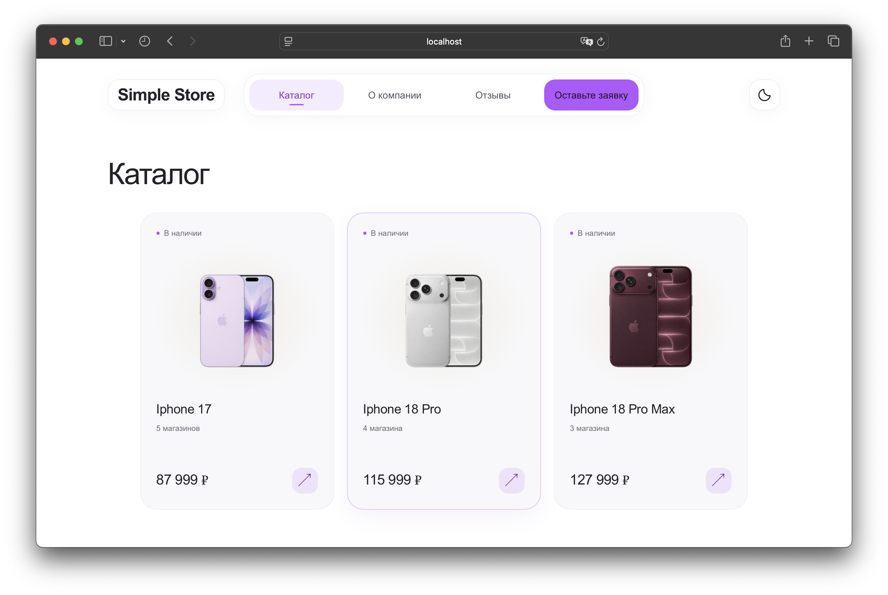
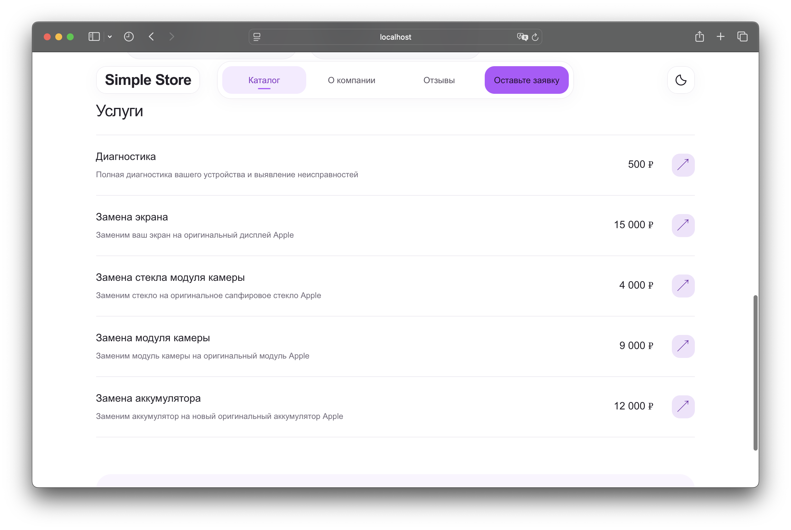
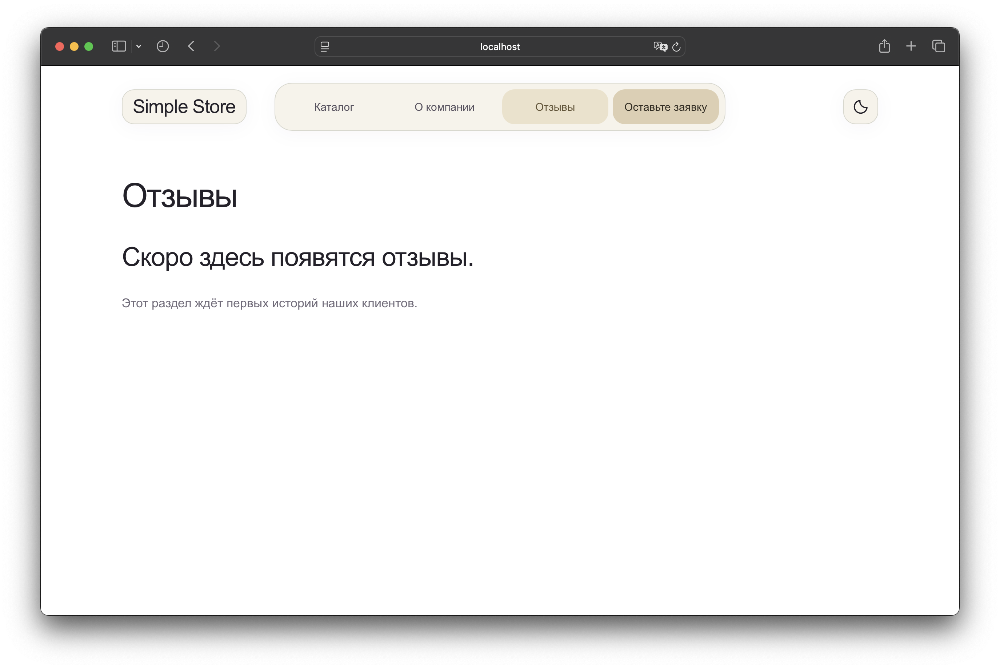
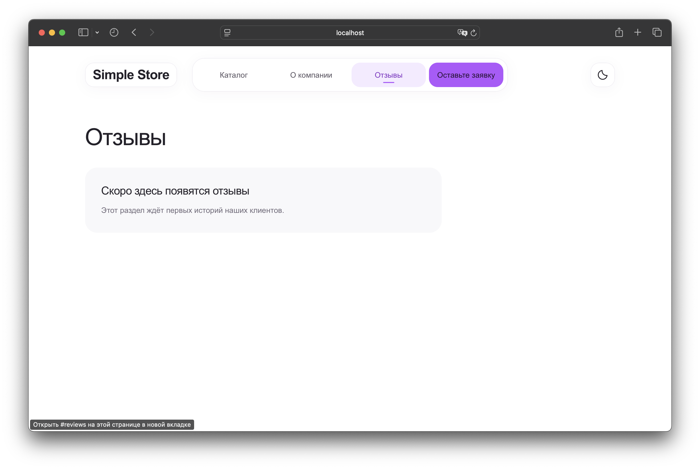
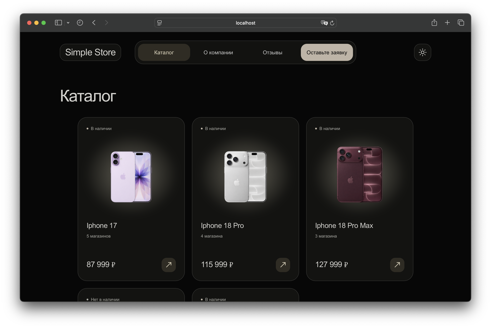
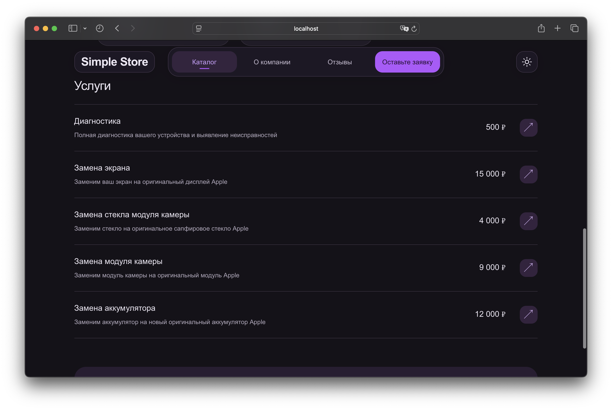
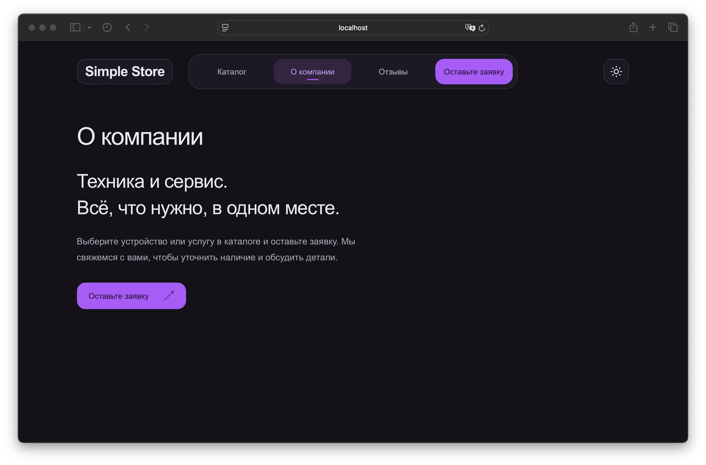
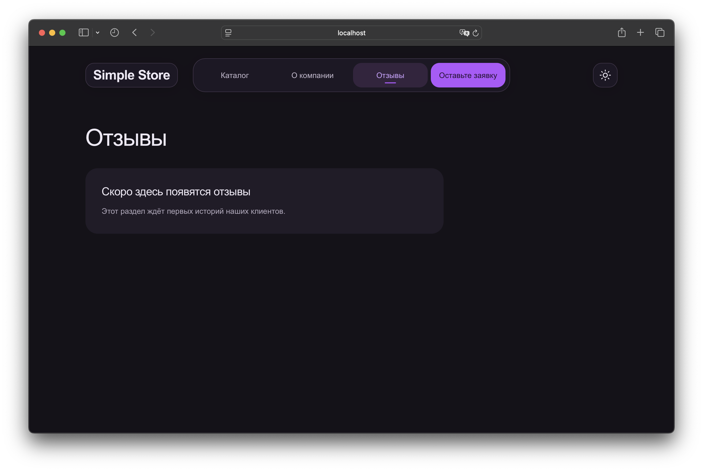

# Simple Store — каталог техники и услуг

Пример сайта-каталога: товары плитками, услуги списком, заявки в существующий Telegram-бот. Светлая/темная тема, скруглённые элементы и плавный блюр. Меню: «Каталог», «О компании», «Отзывы», «Оставьте заявку».

## Функционал

- Каталог товаров и услуг, редактируемый через Google Sheets двумя разными листами. Каждая характеристика соответствует своему столбцу в таблице. Изображения берутся из локальной папки `images`. Возможна реализация через таблицу с ссылками на Google Drive. Листы должны оставаться опубликованными в интернете. Сбой одного листа не блокирует другой.
- Карточки адаптируются к разным разрешениям экрана. Переключение вкладок использует CSS-анимации. При включённой системной настройке уменьшения движения анимации отключены.
- Форма записи, включающая поля «Имя» и «Телефон», размеченные для автозаполнения. Форма отправляет сообщение в бота с уведомлением о новой записи и информацией по имени, номеру и интересующему товару/услуге.
- Интерактивная Яндекс карта.
- Возможность выбора светлой/темной темы.

## Превью сайта

### Светлая тема

<table>

</table>

### Тёмная тема

<table>

</table>
